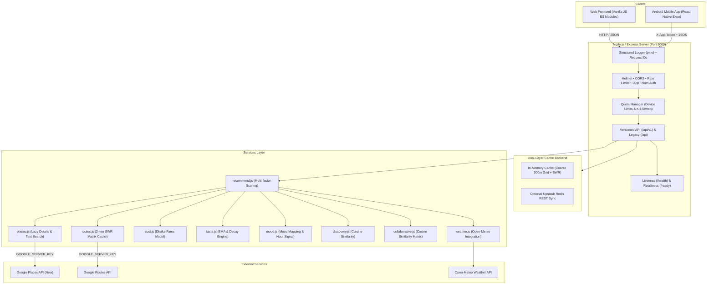
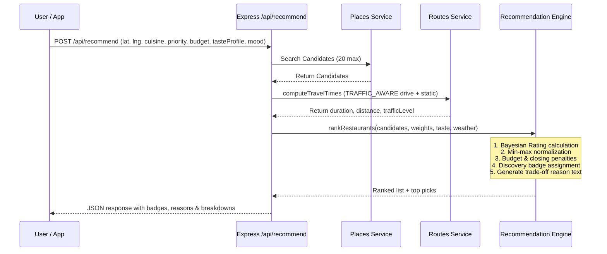

# System Architecture

## Overview
**Khabo Kothay?** (Bangla: খাবো কোথায়?) is a full-stack, traffic-aware dining recommendation system for Gulshan, Banani, Baridhara, and Notun Bazar in Dhaka, Bangladesh. It solves the critical question: *"Where should I actually go right now, and why?"*

Instead of purely listing nearby places by geometric distance, it factors in real-time Dhaka road traffic (Routes API), multi-modal transit costs (rickshaw, CNG, car, walk), user culinary taste affinity, time-of-day mood, and candidate-set rating reliability (Bayesian average).

---

## High-Level Architecture Diagram



---

## Security Model & Key Isolation

1. **Google Server Key (`GOOGLE_SERVER_KEY`)**:
   - Used strictly on the Node.js backend.
   - Never sent to the browser or embedded into the mobile APK.
   - Places photos are streamed via the backend proxy endpoint `GET /api/places/photo?name=...` so Google API credentials never touch the client.
2. **Google Browser Key (`GOOGLE_BROWSER_KEY`)**:
   - Exposed only through `GET /api/config` for rendering Google Maps JavaScript API on the web.
   - Must be restricted in Google Cloud Console by **HTTP Referrer** (e.g. `https://your-domain.com/*` or `http://localhost:*`).
3. **Android Maps Key (`EXPO_PUBLIC_GOOGLE_MAPS_ANDROID_KEY`)**:
   - Restricted in Google Cloud Console by **Android Package Name** (`com.example.cafefinder`) and **SHA-1 Certificate Fingerprint**.
4. **Mobile API Deterrent (`X-App-Token`)**:
   - A secret token (`APP_CLIENT_TOKEN`) checked by the Express server for mobile app traffic.
5. **Content Security Policy (CSP)**:
   - Helmet configured to allow Google Maps scripts, Google static tiles, and font assets while blocking unauthorized scripts.

---

## Data Flow & Scoring Pipeline



---

## How to Add a New Recommendation Factor

1. **Update Weights**: Add the factor weight in [server/config/weights.json](file:///server/config/weights.json) under each priority preset.
2. **Calculate Raw Value**: Calculate the raw metric in a helper service (e.g., parking availability, outdoor seating).
3. **Normalize Factor**: Inside `rankRestaurants()` in [server/services/recommend.js](file:///server/services/recommend.js), normalize the raw metric across candidates to a `0.0 - 1.0` ratio.
4. **Blend into Score**: Multiply by `weights[factorName]` and add to `baseScore`.
5. **Update Reason Generator**: Extend `generateRecommendationReason()` to highlight the factor when significant.
6. **Add Unit Test**: Add assertions in [server/tests/recommend.test.js](file:///server/tests/recommend.test.js).

---

## How to Add a New Mobile Screen

1. Create screen component in `mobile/src/features/<feature>/<FeatureScreen>.js`.
2. Add route to `mobile/App.js` in either `BottomTabs` or `Stack.Navigator`.
3. Add English and Bangla translation strings in `mobile/src/i18n/en.js` and `mobile/src/i18n/bn.js`.
4. Wrap new endpoints in `mobile/src/api/client.js`.

---

## Phase P2 Recommendation Intelligence Architecture

```mermaid
flowchart TD
    UserReq[User Search Request] --> FilterPool[Spatial & Time-Budget Filter]
    FilterPool --> CandidateCheck[Check Round-Trip + Cuisine Dining Duration]
    CandidateCheck --> PrefCheck[Unverified Dietary & Spice Filter]
    PrefCheck --> TrafficPredict[Routes API Departure Time Matrix]
    TrafficPredict --> Scoring[Bayesian + Weights + Context Signals]
    Scoring --> BanditWeights[Simplex Bounded Bandit [0.05, 0.50]]
    BanditWeights --> TopPicks[Ranked Results & Top 3 Picks]
    TopPicks --> Explain[Counterfactual & Prediction Suggestions]
    Explain --> Client[Mobile App / Web UI]
```

### 1. Departure Time Prediction Pipeline
- Top 3 candidate places are evaluated across offsets `+0`, `+15`, `+30`, and `+60` minutes.
- When Google Routes API is enabled, queries `v2:computeRoutes` with `departureTime`.
- When in mock mode or during Google API rate limits, falls back to a modeled Dhaka diurnal traffic curve (rush hours at 08:30-10:30 and 16:30-20:30).
- If departing later saves $\ge 3$ minutes, generates an actionable advice label: *"Leave in 30 min to save 11 min (predicted)"*.

### 2. Time-Budget Mode
- Formulates total journey time: $T_{\text{total}} = 2 \times T_{\text{one-way}} + T_{\text{dine}}(cuisine)$.
- Drops places exceeding the user's available time.
- Drops places that close before $T_{\text{arrival}} + T_{\text{dine}}$.

### 3. Personal Weights Bandit
- Factor weights normalized to sum to 1.0 with strict bounds: $w_i \in [0.05, 0.50]$.
- Updates via stochastic feedback loop with learning rate $\eta = 0.05$.
- Produces plain-language explanation notes and provides an instant reset endpoint.

