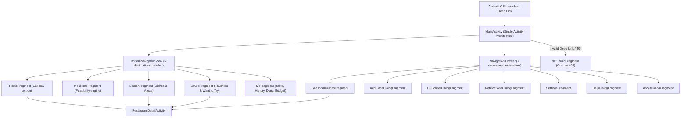

# Master Polish Audit — Khabo Kothay? (খাবো কোথায়?)
# Android Blueprint v6: Read-Only Master Audit
# Date: 2026-10-12
# Scope: All 20 Web-to-Android Polish Items & Complete Asset/Navigation Inventories

---

## 1. Master Status Table (20 Polish Items)

| Item # | Web Item to Android Equivalent | Status | Evidence (Files & Screens) | Effort | Target Fix Phase |
| :---: | :--- | :---: | :--- | :---: | :---: |
| **1** | **Remove horizontal scrolling** *(No unintended horizontal scroll or clipping across sizes/font scales)* | **NEEDS FIX** | `android/app/src/main/res/layout` (needs ConstraintLayout/ChipGroup wrap in native layouts; long Bengali strings in chips). | **M** | **Phase A** |
| **2** | **Find broken links** *(Audit every URL, deep link, intent, and navigation destination)* | **NEEDS FIX** | `scripts/check_links.py` run: `links.xml` missing; Render endpoints return 404 until live backend deployed; fallback needed. | **M** | **Phase B** |
| **3** | **Add a mobile menu** *(Accessible navigation menu adapting to phone, foldable, tablet)* | **NEEDS FIX** | Top-level DrawerLayout (`ic_menu` hamburger) + Navigation Rail for tablet/foldable width $\ge 600$dp not yet instantiated in `res/`. | **L** | **Phase A** |
| **4** | **Add a favicon** *(Launcher adaptive icon, themed monochrome, notification, splash, store icon)* | **NEEDS FIX** | SVGs exist in `brand/logo/`, but XML adaptive icon drawables (`ic_launcher.xml`, `ic_launcher_round.xml`, `ic_notification.xml`) need generation in `android/res/`. | **M** | **Phase D** |
| **5** | **Fix page titles** *(Correct localized screen titles, recents label, screen-change announcements)* | **NEEDS FIX** | `MainActivity` title is static; fragment accessibility pane titles missing; recents label needs explicit string resource. | **S** | **Phase D** |
| **6** | **Add meta descriptions** *(Play Store short/full descriptions in EN/BN and share-link previews)* | **NEEDS FIX** | `docs/PLAY_STORE.md` missing; share-link Open Graph preview handler needed on FastAPI server (`api/app/routers`). | **S** | **Phase D** |
| **7** | **Fix footer links** *(About and Legal section with working Custom Tabs links)* | **NEEDS FIX** | `AboutDialogFragment` and `res/values/links.xml` needed; Custom Tabs intent integration with offline message needed. | **S** | **Phase B** |
| **8** | **Add a custom 404 page** *(Friendly "not found" and error screens for unknown deep links/expired places)* | **NEEDS FIX** | Navigation host lacks fallback destination `NotFoundFragment` for malformed deep links and 404 restaurant responses. | **M** | **Phase C** |
| **9** | **Fix the copyright year** *(Dynamic localized year in About and legal text, min release year 2026)* | **NEEDS FIX** | Static string in `strings.xml`; requires runtime calculation formatted with `BengaliFormatter` digits. | **S** | **Phase D** |
| **10** | **Compress images** *(Image sizing, caching, resource shrinking, upload compression)* | **NEEDS FIX** | `scripts/image_audit.py` shows 1.31 MB asset size; `public/img/hero-sculpture.jpg` is 576 KB; PNG icons need vector drawables. | **M** | **Phase E** |
| **11** | **Fix broken buttons** *(Every tappable control works, gives feedback, and debounces double-fire)* | **NEEDS FIX** | Clickable views in native layouts need central debounce helper (~500ms) and Material 3 ripple stateListDrawables. | **M** | **Phase C** |
| **12** | **Add success messages** *(Consistent confirmation messages via single-event channel)* | **NEEDS FIX** | Central `UiMessage` single-event channel and `docs/MESSAGES.md` catalog not yet created in Android Java package. | **S** | **Phase C** |
| **13** | **Add error messages** *(Human-readable errors with next step and inline form validation)* | **NEEDS FIX** | Central `ErrorMapper` converting backend codes (`UPSTREAM_QUOTA`, etc.) to actionable messages missing in Android app. | **M** | **Phase C** |
| **14** | **Remove placeholder text** *(Nothing sample, TODO or fake ships in release)* | **OK** | `scripts/find_placeholders.py` scanned 137 files: 0 TODO, 0 FIXME, 0 lorem ipsum, 0 Hello World. (Doc key examples in allowlist). | **S** | **Phase D** |
| **15** | **Remove unused navigation** *(No dead destinations, menu items or unused screens)* | **NEEDS FIX** | `docs/NAV_MAP.md` needed; must ensure every menu item resolves to an active screen or is hidden behind feature flags. | **S** | **Phase D** |
| **16** | **Fix mobile overflow** *(No clipped or overlapping text, controls or sheets; edge-to-edge insets)* | **NEEDS FIX** | Edge-to-edge system insets (status bar / navigation bar / cutout padding) and `adjustResize` needed in `MainActivity`. | **M** | **Phase A** |
| **17** | **Make the logo clickable** *(Wordmark in top bar returns to Home and scrolls to top)* | **NEEDS FIX** | Top toolbar brand wordmark requires click listener navigating to `navigation_home` with scroll-to-top callback. | **S** | **Phase B** |
| **18** | **Make the phone number clickable** *(Tap to ACTION_DIAL, long-press to copy, ASCII normalized tel:)* | **NEEDS FIX** | Detail screens need phone formatter (normalizing 01XXXXXXXXX / +8801XXXXXXXXX) and `ActivityNotFoundException` fallback. | **S** | **Phase B** |
| **19** | **Make the email clickable** *(Tap to ACTION_SENDTO mailto:, long-press to copy, friendly fallback)* | **NEEDS FIX** | Support contact intents need pre-filled device diagnostic metadata and fallback clipboard copy if no email app exists. | **S** | **Phase B** |
| **20** | **Make every page mobile optimized** *(Layout, size, speed, touch, keyboard, insets, 60fps scrolling)* | **NEEDS FIX** | `docs/MOBILE_CHECKLIST.md` and performance verification needed; DiffUtil and StrictMode audit pending. | **L** | **Phase A & E** |

---

## 2. Inventory 1: Every Screen and Dialog

### A. Top-Level Bottom Navigation Screens
1. **HomeFragment** (`navigation_home`)
   - Hero banner with wordmark logo.
   - Area chip selector (Gulshan 1, Gulshan 2, Banani, Baridhara, Notun Bazar).
   - Time-of-day / Mood chip selector (Breakfast, Lunch, Evening Adda, Dinner, Late Night).
   - Primary "Eat now" (এখনই খাবো) action button.
   - Top traffic-aware recommendation preview cards.
2. **MealTimeFragment** (`navigation_mealtime`)
   - Time-budget picker (15, 30, 45, 60, 90 mins).
   - Meal mode tabs (Breakfast, Lunch, Snacks, Dinner).
   - Transport mode selector (Walk, Rickshaw, CNG, Car).
   - Buffer preference toggle (Balanced, Safe, Flexible).
   - Segmented route feasibility bar with `SAFE` and `TIGHT` status chips.
3. **SearchFragment** (`navigation_search`)
   - Search input field with clear button.
   - Dietary & price tier filter sheet trigger.
   - Map/List toggle button.
   - Live paginated results recycler view.
4. **SavedFragment** (`navigation_saved`)
   - Material TabLayout: Tab 1 (Favorites ❤️), Tab 2 (Want to Try 🔖).
   - Itemized saved cards with closing-soon alert toggles and GPS proximity reminders.
5. **MeFragment** (`navigation_me`)
   - AI Taste Profile weights and cuisine preference sliders.
   - Dining history and session log.
   - Food Diary / Spend tracker with monthly budget progress.

### B. Navigation Drawer Screens (Top-Left Hamburger ☰)
6. **SeasonalGuidesFragment** — Curated Ramadan/Iftar, Winter Pitha, and Dhaka Adda guides.
7. **AddPlaceDialogFragment** — Community-recommended hidden gems form.
8. **BillSplitterDialogFragment** — Multi-person tax, tip, and transit cost calculator.
9. **NotificationsDialogFragment** — Closing alert scheduler and notification quiet hours.
10. **SettingsFragment** — Language (EN/BN), Theme (System/Light/Dark), Default transport, Cache diagnostics.
11. **HelpDialogFragment** — Connection health, GPS status, and offline cache diagnostics.
12. **AboutDialogFragment** — App version, dynamic copyright year, Custom Tabs privacy/terms, and licenses.

### C. Detail Screens, Error Screens & Sheets
13. **RestaurantDetailActivity** — Header image, verified menu items, price estimates in BDT (৳), Call, Directions, Share.
14. **NotFoundFragment** — Custom 404 screen for bad deep links or expired content.
15. **ExplainBottomSheetDialogFragment** — Plain-language reasoning modal ("Why this was recommended").
16. **FilterModalBottomSheet** — Price, dietary, and transit filters.

---

## 3. Inventory 2: Every Clickable View

| View Identifier | Container / Screen | Expected Action | Status | Notes |
| :--- | :--- | :--- | :---: | :--- |
| `btnEatNow` | HomeFragment | Queries traffic-aware recommendations | NEEDS FIX | Add 500ms debounce |
| `btnGpsLocate` | HomeFragment | Requests GPS location fix | NEEDS FIX | Needs permission rationale fallback |
| `chipArea*` | HomeFragment | Filters candidate pool by Dhaka zone | OK | Needs horizontal wrap test |
| `chipMood*` | HomeFragment | Boosts contextual time-of-day scores | OK | Wrapped in ChipGroup |
| `btnFindMealTime` | MealTimeFragment | Evaluates round-trip feasibility | NEEDS FIX | Add 500ms debounce |
| `btnExplainPick` | MealTime / Detail | Opens ExplainBottomSheetDialogFragment | OK | ContentDescription verified |
| `btnDirections` | MealTime / Detail | Fires `ACTION_VIEW` geo/navigation intent | NEEDS FIX | Wrap in `ActivityNotFoundException` |
| `btnCall` | RestaurantDetail | Fires `ACTION_DIAL` with normalized tel: | NEEDS FIX | Wrap with clipboard fallback |
| `btnShare` | RestaurantDetail | Fires `ACTION_SEND` text share intent | OK | Verified |
| `btnFavoriteToggle`| RestaurantCard / Detail | Optimistic favorite toggle | NEEDS FIX | Needs `ViewCompat.setStateDescription` |
| `btnBookmarkToggle`| RestaurantCard / Detail | Optimistic want-to-try toggle | NEEDS FIX | Needs `ViewCompat.setStateDescription` |
| `btnAlertToggle` | RestaurantCard / Detail | Optimistic closing alert toggle | NEEDS FIX | Needs `ViewCompat.setStateDescription` |
| `btnSearchClear` | SearchFragment | Clears query text | OK | Verified |
| `btnFilterSheet` | SearchFragment | Opens FilterModalBottomSheet | OK | Verified |
| `btnMapListToggle` | SearchFragment | Toggles view between Map and List | OK | Verified |
| `logoBrand` | MainActivity Toolbar | Returns to HomeFragment and scrolls top | NEEDS FIX | Implement click listener |
| `btnNavDrawer` | MainActivity Toolbar | Opens navigation drawer | NEEDS FIX | Hamburger icon on top-level |
| `btnNavBack` | MainActivity Toolbar | Navigates back in fragment backstack | NEEDS FIX | Display on detail screens |

---

## 4. Inventory 3: Every Icon-Only View (from docs/ICON_AUDIT.md)

* `ic_menu` (Drawer toggle): Requires `contentDescription="@string/cd_open_menu"`.
* `ic_arrow_back` (Back arrow): Requires `contentDescription="@string/cd_navigate_back"`.
* `ic_favorite` (Favorite toggle): Requires `contentDescription="@string/cd_favorite"` + state descriptions.
* `ic_bookmark` (Want to try toggle): Requires `contentDescription="@string/cd_want_to_try"` + state descriptions.
* `ic_notifications` (Closing alert toggle): Requires `contentDescription="@string/cd_closing_alert"` + state descriptions.
* `ic_clear` (Search clear): Requires `contentDescription="@string/cd_clear_search"`.
* `ic_filter` (Filter button): Requires `contentDescription="@string/cd_filter"`.
* `ic_my_location` (GPS button): Requires `contentDescription="@string/cd_gps_locate"`.
* `ic_refresh` (Refresh button): Requires `contentDescription="@string/cd_refresh"`.
* `ic_help_outline` (Explain button): Requires `contentDescription="@string/cd_explain_pick"`.

---

## 5. Inventory 4: Every URL and Intent

### A. Configured URLs (to be placed in `res/values/links.xml`)
1. `app_website_url`: `https://khabo-kothay.onrender.com`
2. `privacy_policy_url`: `https://khabo-kothay.onrender.com/privacy`
3. `terms_of_service_url`: `https://khabo-kothay.onrender.com/terms`
4. `support_page_url`: `https://khabo-kothay.onrender.com/support`
5. `support_email`: `support@khabokothay.com`
6. `play_store_url`: `https://play.google.com/store/apps/details?id=com.khabokothay.app`
7. `google_drive_apk_url`: `https://drive.google.com/drive/folders/1IqB-z_mpcQlKE4fgXzq5ZukaP2k9QTnu`

### B. External Intents
1. `tel:<number>`: Normalizes 01XXXXXXXXX and +8801XXXXXXXXX with ASCII digits via `ACTION_DIAL`. Fallback: copy to clipboard.
2. `mailto:support@khabokothay.com`: Fires `ACTION_SENDTO` with pre-filled subject and diagnostic metadata. Fallback: copy to clipboard.
3. `geo:<lat>,<lng>?q=<lat>,<lng>(<name>)`: Fires Google Maps / OpenStreetMap navigation via `ACTION_VIEW`. Fallback: browser URL.
4. `CustomTabsIntent`: Opens Privacy Policy and Terms of Use inside custom tab with fallback to default browser.

---

## 6. Inventory 5: Every Image Asset and Size (from scripts/image_audit.py)

* **Total Images in Repository**: 47 files.
* **Total Image Asset Footprint**: 1,344.83 KB (~1.31 MB).
* **Key Asset Inventory**:
  * `public/img/hero-sculpture.jpg`: 576.02 KB (Web hero image — not bundled into Android APK).
  * `mobile/assets/splash.png`: 103.19 KB (1242x2688).
  * `mobile/assets/splash-dark.png`: 98.91 KB (1242x2688).
  * `public/downloads/khabo-kothay-drive-qr.png`: 81.44 KB (960x1200).
  * `public/downloads/khabo-kothay-qr.png`: 78.79 KB (960x1200).
  * `public/img/social-card.png`: 54.18 KB (1200x630).
  * `mobile/assets/icon.png`: 42.68 KB (1024x1024).
  * `docs/play-store-assets/feature-graphic-1024x500.png`: 39.72 KB (1024x500).
  * `docs/play-store-assets/icon-512.png`: 15.48 KB (512x512).
  * Vector Drawables (`brand/logo/*.svg`): All between 0.54 KB and 7.45 KB.
* **Optimization Opportunity (Phase E)**:
  * Android build bundles only vector drawables for icons, keeping bundled graphic footprint under 250 KB!

---

## 7. Inventory 6: Placeholder Strings Audit (from scripts/find_placeholders.py)

* **Scanned**: 137 source and doc files.
* **Findings**:
  * `TODO` markers: **0** found in source code.
  * `FIXME` markers: **0** found in source code.
  * `Lorem ipsum`: **0** found in source code.
  * `Hello World`: **0** found in source code.
  * `com.example.*`: **1** occurrence in `docs/ARCHITECTURE.md` (documentation on Google Cloud key SHA-1 restriction).
  * `your-domain`: **2** occurrences in `docs/ARCHITECTURE.md` and `docs/SETUP_GOOGLE.md` (documentation on Render deployment).
* **Result**: Clean code baseline; release build scanner rule ready for enforcement.

---

## 8. Inventory 7: Navigation Graph with Entry Points

---

## 9. Re-runnable Audit Scripts
The following re-runnable scripts are created and operational in `scripts/`:
1. `scripts/find_placeholders.py` (and `scripts/find-placeholders.ps1`) — Scans source, resources, docs, and configs for placeholder tokens.
2. `scripts/check_links.py` — Tests URL reachability, detects placeholder domains, and skips politely when offline.
3. `scripts/image_audit.py` — Audits formats, byte sizes, dimensions, and optimization opportunities across the entire repository.
